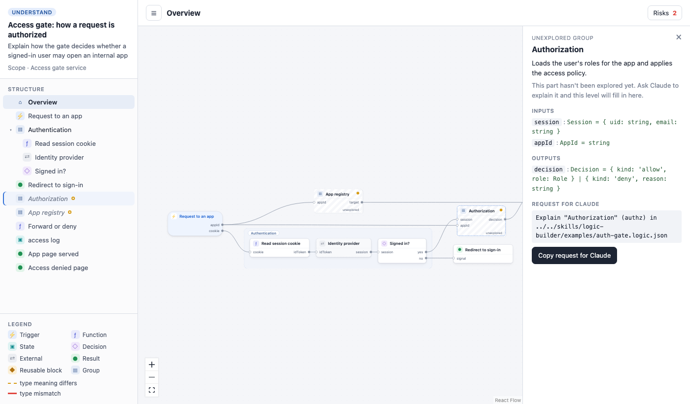
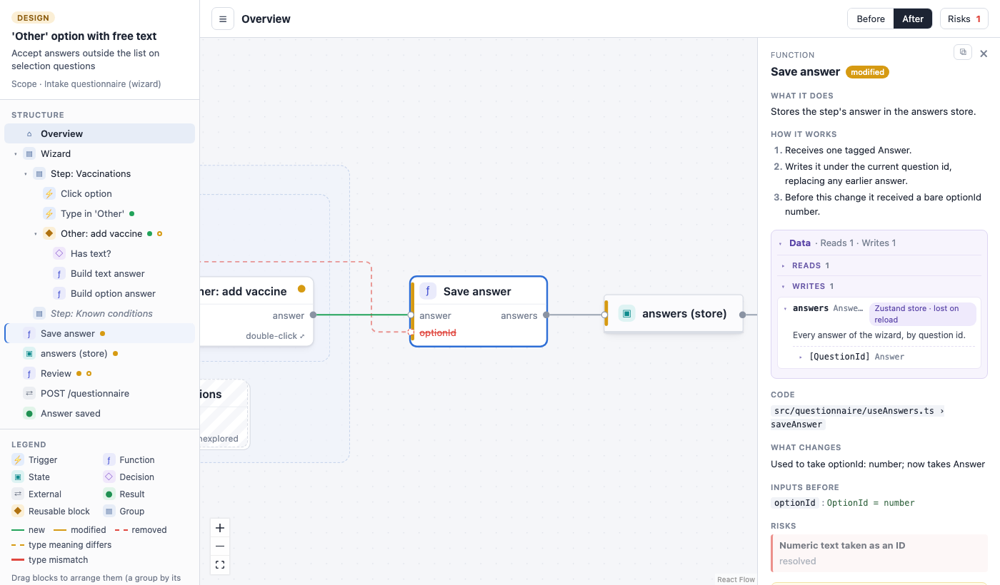

# The viewer

The viewer is a local web page that draws a `*.logic.json` file as a Function Block Diagram. You
read the diagram, ask questions about it, and fix what looks wrong before any code is written.
You can also change it: rename blocks, edit types, leave notes, and send the result back to the
agent.

This page covers every control in the viewer. For the blocks and wires themselves, see
[the blocks page](blocks.md). For the file format, see
[`format.md`](../skills/agentic-fbd/references/format.md).

## Opening it

Claude opens the viewer for you after it writes a diagram. To open one yourself, run the CLI
from the plugin or from a clone of the repo:

```bash
node dist/cli.mjs open logic/auth-gate.logic.json
```

The viewer serves on `127.0.0.1` only and reloads when the file changes on disk. If you ask for
a change in the chat, the diagram updates in front of you. The [CLI page](cli.md) lists the
flags (`--port`, `--no-open`). How the agent decides when to write or offer a diagram is on the
[skill page](skill.md).

The address keeps the level, the Before/After choice and the diagram you are looking at
(`#/group-id?mode=before&file=other.logic.json`), so a reload puts you back where you were.

## The screen



The screen has four parts:

- **Structure panel** on the left: the subject, the other diagrams, a tree of levels and blocks,
  and a legend.
- **Top bar**: where you are, plus the controls that apply to the whole level.
- **Canvas** in the middle: the diagram of the current level. Zoom with the mouse wheel or the
  zoom buttons in the bottom left corner. Drag the background to pan.
- **Side panel** on the right: opens when you click a block or wire, or the **Risks** button.

## Reading a diagram

### Structure panel

The panel has four parts, from top to bottom.

- **Header.** A chip says **Understand** or **Design**. Under it are the subject's title, its
  intent and its scope (`Scope · ...`).
- **Diagrams.** Shown only when the folder holds more than one `*.logic.json` file. The one on
  screen has a filled marker. Click another to open it. A small dot next to a diagram means it
  has unsaved edits (see [Draft](#the-draft-save-and-discard)).
- **Structure.** A tree with **Overview** at the top, then every block of the diagram. Groups
  and reusable blocks can be expanded with the arrow on their row. Click a row to go to that
  level and select the block. A group you haven't explored yet is shown in italics. Two kinds of
  dot may appear on a row:
  - a change mark (new, modified, removed or affected), in a Design diagram when you are in the
    **After** view;
  - an **Open risk** dot (a hollow ring).
- **Legend.** The icon of each block kind (Trigger, Function, State, Decision, External,
  Result, Reusable block, Group), and the wire colors: **new**, **modified** and **removed**
  (Design only), **type meaning differs**, and **type mismatch**. A short hint at the bottom
  repeats how to arrange and select blocks.

The **☰** button at the left of the top bar hides or shows the panel (**Hide structure** and
**Show structure**).

### The top bar

From left to right:

| Control | What it does |
|---|---|
| **☰** | Hides or shows the structure panel. |
| **↑ Parent name** | Goes up one level. Its tooltip says **Up one level (Esc)**. Shown only when you are inside a group or a reusable block. |
| Level name (bold) | The level you are on. At the top it reads **Overview**. |
| **offline** | Shown when the viewer lost its connection to the local server. The diagram on screen is the last one it received. |
| **layout not saved** | Shown when the arrangement you made by hand could not be written. It is kept until you reload. |
| **Auto layout** | Shown only when the current level has positions you set by hand. Goes back to the automatic arrangement. |
| **Before** / **After** | Shown only for a Design diagram. See [Before and After](#before-and-after). |
| **Risks** and a count | Shown only when the diagram has risks. The count is the number of open risks. Click to open the risk list. |

If the file on disk has validation errors, a banner appears under the bar: `N validation errors
in <file> — showing the last valid version`, with the first eight messages. The viewer keeps
showing the last version that was valid. Fix the file (or ask the agent) and the banner goes.

### Levels

A diagram is made of layers. The top level is the **Overview**. A group or a reusable block can
hold a level of its own.

- **Double-click** a group or a reusable block to go inside it. Blocks you can open show
  **double-click** in small text. The panel of such a block also says **Double-click to see
  inside.**
- **Esc** goes back up. It steps back one thing at a time: first it clears the selection, then
  it closes the side panel, then it goes up one level. (With the Risks list open, Esc skips the
  panel step and goes up.)
- The **↑** button in the top bar, or any row of the structure panel, also moves between
  levels.
- When a level is small enough, a group is drawn as a dashed frame with its children inside. A
  larger one is drawn as a single block that you double-click.
- Inside a level, a wire that comes from or goes to something outside it ends in a flag with
  the name of the outside end. Its tooltip says where the wire comes from or goes to.

When a level opens, the view fits to it. It never zooms out so far that labels are unreadable.
The zoom buttons in the bottom left are zoom in, zoom out and fit view.

### Blocks on the canvas

Each block has a kind icon, a name, and its input ports on the left and output ports on the
right. A state is drawn as a store with its own shape. Small marks can appear on a block:

| Mark | Meaning |
|---|---|
| Amber dot | **Open risk** on this block, or **Open risk inside** it. |
| Fainter amber dot | **Changes inside**: something inside a group changed (Design, After view). |
| **↗** | The block is explained in another diagram. The tooltip names it. |
| **✎** | The block has a note for the agent. The tooltip shows the note. |
| Hatched fill and **unexplored** | An unexplored group. See [Unexplored groups](#unexplored-groups). |

### Wires

- **Hover** a wire to see a tooltip: the type name, its full shape, whether it reads or writes a
  state, and where it goes (`from → to`). If several wires are drawn as one line, the tooltip
  adds `(+N more)`. It also says when a wire is removed by the change, when the types fit by
  shape but differ in meaning (**Fits by shape, but the types differ in meaning.**, with a
  **!** on the wire), and when they are incompatible (**Incompatible types.**).
- **Click** a wire to open its panel. It shows the wire's name (`from → to`), what it
  **Carries** (the type, which can be expanded to its fields), its **Operation** when it reads
  or writes a state, and a **Note for agent**. In the After view you can also remove it. See
  [Changing a diagram](#changing-a-diagram).

#### Labeled connectors

A wire is a line. As on an electrical schematic, a wire that would be hard to follow is drawn
differently: as a pair of arrow flags, one next to the output (**Goes to X**) and one next to
the input (**Comes from Y**). The viewer does this when a wire is very long, loops far back, or
crosses several others. If a flag stands for several blocks, it shows a **⋯** icon.

**Click a flag** to see the other end: the viewer zooms to the flag and the block or blocks it
points at, and highlights them. A diagram can force a line or flags on a wire with `draw` (see
[`format.md`](../skills/agentic-fbd/references/format.md)).

### The block panel

Click a block to open its panel on the right. Sections appear only when they have content.

- **Kind** (Trigger, Function, Reusable block, ...), then the block's name. In a Design diagram,
  a tag next to the name says **new**, **modified**, **removed** or **affected** in the After
  view.
- **What it does**: a one-line description.
- **How it works**: the steps, in order.
- **Explained in another diagram**: a button **Open <file> › <block> ↗** that follows the link. See
  [Linked diagrams](#linked-diagrams).
- **Context** (triggers only): the trigger's **source** and its context keys, such as `from` and
  `modes`.
- **Data**: what the block reads and writes. See [the Data box](#the-data-box).
- **Code**: the file, and the function, the block maps to.
- **What changes**: Design only. The note on what is different, plus **Inputs before** and
  **Outputs before** when ports changed.
- **Instances of “X” · used in N places**: on a reusable block, a link to every place where it
  is used. Click one to go there.
- **Risks**: the risks that point at this block, with their status.
- **Note for agent**: a free note. You can write it yourself (see [Notes](#notes)).
- **Remove** or **Restore**: In the After view only. See [Changing a diagram](#changing-a-diagram).

A block with no description shows **No explanation yet. Ask the agent to describe this block.**

A block that stands for something outside the level (a boundary flag) opens a short panel titled
**Boundary**, which says where it connects to.

The **x** at the top right closes the panel and clears the selection. Clicking an empty part of
the canvas closes it too (except the Risks list).

The **copy icon** at the top of a block or wire panel is **Copy reference for agent**. See
[Copy reference for agent](#copy-reference-for-agent).

### The Data box

Under the explanation, a **Data** box tells you what the block reads and writes, with types,
fields and where the data lives. It starts collapsed, and so does every section inside it. It
does not remember what you opened.

The header shows a summary and opens or closes the box. The contents depend on the block:

| Block | Summary | Sections |
|---|---|---|
| Function, trigger, decision, external, result | **Reads N · Writes N** (and **Responses N** when there are some) | **Reads**, **Writes**, **Responses** |
| State | **Read by N · Written by N**, and what the state holds | **Written by**, **Read by**: each lists the blocks, and clicking one opens its level and selects it |
| Group | **Comes in N · Goes out N** | **Comes in**, **Goes out**: only the data that crosses the group's edge, then **+N more inside · double-click to open** |

A block with no data has no Data box.

Each row is one port or state. It shows the name and the type. If the data lives somewhere
specific, that appears next to it (for example `Zustand store · lost on reload` or `Postgres
table bookings`). A row with fields, a code reference or a description has an arrow: open it to
see the fields (nested ones have their own arrow), the description, and the code it maps to.



### Before and After

A Design diagram has two views of the same diagram. The **Before** and **After** buttons in the
top bar switch between them.

- **After** is the result of the change. New, modified and affected blocks carry marks, and what
  the change removes is drawn faded, so you can still see where wires used to attach.
- **Before** is the diagram without the new items and with the old values of the modified ones.

Only the After view can be edited. The structure tree and the legend show the change marks in
the After view only. A diagram in Understand mode has no Before/After buttons. They appear once
an edit turns the draft into a Design diagram (see [Changing a diagram](#changing-a-diagram)).

The marks (`change`, `changeNote`, `before`) are described on [the blocks page](blocks.md).

### Risks

Click **Risks** in the top bar to list the risks of the diagram, open ones first. Each entry has
a title, a severity and status, the detail, and a **Resolution** when it is resolved.

**Click a risk** to go to the level where it applies and highlight the blocks and wires it
points at. Clicking an empty part of the canvas does not close the list; use the **x**.

### Linked diagrams

A large subject can be split into one diagram per system, linked with `see`. A block that has a
`see` link shows a **↗** badge.

- **Double-click** the block, or use the **Open … ↗** button in its panel, to open the diagram
  that explains it, at the right block.
- The **Diagrams** list in the structure panel shows every diagram in the folder.

`validate` warns about `see` links that point at files or blocks that don't exist (see the
[CLI page](cli.md)).

### Unexplored groups

Claude explains a subject one layer at a time. A group it hasn't opened yet is an **unexplored
group**. It is drawn hatched, with **unexplored** on it, and its ports are the ones the diagram
declares. Click it, or double-click it, to open its panel. It shows the group's description, its
**Inputs** and **Outputs**, and a **Request for the agent**: a one-line prompt
(`Explain "Authorization" (authz) in logic/auth-gate.logic.json`). **Copy for agent** copies the
prompt. Paste it into Claude Code and the group fills in.

## Changing a diagram

Everything you change stays in a draft until you save. Nothing is written to the diagram file
before then.

### What you can edit

Every editable field shows a small pencil when you hover over it. There is no separate edit
mode. Click the pencil, type, then press **Enter** or click **OK**. **Esc** or **Cancel** drops
the change. Multi-line fields (descriptions and notes) use **Save** and **Cmd/Ctrl+Enter**
instead, because Enter adds a line. If the change is not valid, the reason appears under the
field and the field stays open.

| Where | What you can change |
|---|---|
| Block panel | The block's name (**Block name**), **What it does**, the function name next to the code file (**name a function**). |
| Trigger **Context** | The **source** (user, schedule, http, agent, system), and the `from` and `modes` keys. |
| **Data** box rows | A port's name and its type, for a block's **Reads**, **Writes** and **Responses**. |
| Fields of a type | Rename a field, change its type, remove it with **x** (**Remove field**), or add one with **+ field** (enter a name and a type, then **Add**). This changes the named type itself, so it applies everywhere that type is used. |
| **Note for agent** | A free note on a block or a wire. |
| **Remove** / **Restore** | Remove a block or a wire, or take the removal back. |

Some limits:

- Edits are available only in the **After** view.
- A removed block can't be edited until you **Restore** it.
- A boundary flag can't be edited. Edit the port on its own block.
- On a reusable block, ports belong to the block type. The viewer asks first: **Changes all N
  uses of X**, with **Cancel** and **Apply**.
- **Remove** on a group asks first: **Removes this block and N inside it**, with **Cancel** and
  **Remove**.
- A block or wire that is new in this design is deleted outright. Anything else is marked
  removed and kept on the canvas as a ghost, so the agent knows what to take out. **Restore**
  is offered for things you removed in this editing session.
- Nothing is deleted from the canvas with the keyboard.

Edits also mark the diagram the way a design does. An existing block you change becomes
`modified`, and its old value is kept in `before`. If the diagram was in Understand mode, the
first edit other than a note changes it to Design mode in the draft.

### Notes

A note is a request to the agent that marks nothing. Click the pencil under **Note for agent**
in a block or wire panel. A block with a note shows a **✎** badge. Notes don't switch
the diagram to Design mode.

### The draft, Save and Discard

While you have unsaved edits, a bar appears at the bottom of the canvas.

- **N unsaved changes** (or **No changes left**, if you undid everything). It counts what
  differs from the file when you started editing, not each keystroke.
- **Save** writes the draft over the diagram. It is disabled while the draft has a validation
  error (the first error is shown in the bar), when there is nothing left to save, and while
  saving (**Saving…**).
- **Discard** drops every edit. It asks first: **Discard every edit?** with **Keep editing**
  and **Discard**.

Two notes can appear above the row:

- **The diagram changed on disk while you edited. Saving keeps your version; the other one is
  kept for review.** The agent (or you) changed the file while you had edits. Your version wins,
  and the other one goes to `<name>.review.json`.
- **Your edits could not be written next to the diagram; they are kept until you reload.** The
  draft file could not be saved.

The viewer writes your draft to disk a moment after each edit, so a reload doesn't lose it.

### Copy for agent

After a successful save the bar changes to **Saved**, with the text **Ask the agent to
implement your edits.** and a **Copy for agent** button. It copies a request like this one:

```text
I edited logic/auth-gate.logic.json in the viewer. Please review and implement:
- Renamed "Read session cookie" → "Read session" (verify)
- Renamed function readSessionCookie → readSession in "Read session" (verify)
- Note on "Forward or deny" (proxy): log the denied app id too
```

Each line is a difference between the file as it was when you started editing and the file you
saved. Paste the text into Claude Code. The bar goes away after 20 seconds, or when you start
another edit, so copy the request right after you save. If a review file was kept, the bar adds
**The other version is in `<name>.review.json` for the agent to review.**

The button called **Copy for agent** appears in three places, and each one copies something
different:

| Where | What it copies |
|---|---|
| The **Saved** bar | The request to implement your edits, as above. |
| The panel of an unexplored group | The request to explain that group. |
| The panel shown when several blocks are selected | The reference to those blocks (see below). |

### Copy reference for agent

When you want to point at a block or a wire in a prompt, copy a reference to it. It does not
change anything.

- In the panel of a block or a wire, click the copy icon (**Copy reference for agent**) at the
  top. The icon turns into **Copied** for a moment.
- To refer to several blocks, select them (see [the table below](#keyboard-and-mouse)). The
  panel shows **N blocks selected** and the list. Its **Copy for agent** button copies the
  reference for all of them.

The reference is the file path and one line per item: the block's name, its id, its kind and the
code it maps to.

```text
logic/auth-gate.logic.json
- "Forward or deny" (id: proxy, function) → server/proxy.ts · handleRequest
- "access log" (id: access-log, state) → server/audit.ts · accessLog
```

A wire gets a line with its id and its two ends, and its type when it has one. Paste the
reference in a prompt such as "What happens in these two blocks when the app id is unknown?"

### Arranging by hand

The automatic layout is a good start, but you can tidy a level.

- **Drag** a block to move it. Drag an open group (a dashed frame) by its label. The frame grows
  to keep its children.
- A block you drag alone snaps level with the other end of a wire when it comes close, so wires
  can be made straight.
- Select several blocks and drag them together. They don't snap.
- Positions are saved when you drop, per level, in `<name>.layout.json`.
- **Auto layout** (top bar) drops the saved positions of the level you are on and lays it out
  again. It appears only when that level has saved positions.

Blocks the layout file doesn't know yet (the agent added them) are placed next to their
neighbors, where they cover nothing.

### What lands in which file

All four files sit in the same folder as the diagram. `<name>` is the diagram's file name
without `.logic.json`.

| File | Written by | When | Notes |
|---|---|---|---|
| `<name>.logic.json` | The agent, and the viewer on **Save** | You save, or the agent changes the diagram | The diagram. Save rewrites the whole file with 2-space indentation. |
| `<name>.layout.json` | The viewer | You drop a block, or click **Auto layout** | Block positions, per level. Optional. Commit it with the diagram if you want others to see your arrangement. It is deleted when no level has saved positions. |
| `<name>.draft.json` | The viewer | Right after each edit | Your unsaved edits, plus the text of the diagram when you started. Deleted by **Save** and **Discard**. It is a working file, not something to commit. |
| `<name>.review.json` | The viewer | On **Save**, only if the diagram changed on disk while you edited | The other version, for the agent to review. The viewer never deletes it. |

The agent doesn't write the layout, draft or review files. None of their names end in
`.logic.json`, so none is listed as a diagram. See the [CLI page](cli.md) for how `open` serves
the folder.

## Keyboard and mouse

| Action | Result |
|---|---|
| Click a block | Opens its panel. |
| Double-click a group or reusable block | Goes inside it. |
| Double-click a block with a link (**↗**) | Opens the linked diagram. |
| Double-click an unexplored group | Opens its panel. |
| Click a flag | Shows the other end of the wire. |
| Click a wire | Opens its panel. |
| Hover a wire | Shows its type and ends. |
| Click the canvas background | Closes the panel (not the Risks list) and clears the highlight. |
| **Esc** | Clears the selection, then closes the panel, then goes up one level. |
| Shift-click, Cmd-click or Ctrl-click a block | Adds it to the selection. |
| Shift-drag on the background | Selects the blocks in the box. |
| **Cmd+A** / **Ctrl+A** | Selects every block in the level. |
| Drag a block | Moves it. Alone, it snaps level with a wire's other end. |
| Drag a frame by its label | Moves the group and its children. |
| Drag the background | Pans. |
| Mouse wheel, or the **+** and **-** buttons | Zooms. The third button fits the view. |
| Pencil, then **Enter** | Commits a one-line edit. |
| **Cmd+Enter** / **Ctrl+Enter** | Commits a multi-line edit (description or note). |
| **Esc** while editing a field | Cancels that edit. |

Keyboard shortcuts are ignored while you type in a field. Double-click doesn't zoom.

## The viewer without a server

The website's **Try it** section runs this same viewer from static files, with no `open` server
behind it. Everything above works, but drafts, arrangements and saves are kept in memory until
you close the tab, and nothing is written to disk.
